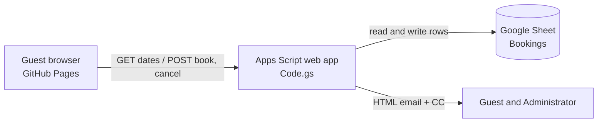

<div align="center">


# Service Apartment Booking

A lightweight booking system for Raygun's service apartments. Staff pick a location, tap the nights they need, and get an instant HTML confirmation by email. No servers, no database licences, no monthly cost.


</div>

---

## Contents

- [Features](#features)
- [How it works](#how-it-works)
- [Repository layout](#repository-layout)
- [Setup](#setup)
- [Configuration](#configuration)
- [Data model](#data-model)
- [API reference](#api-reference)
- [Updating and redeploying](#updating-and-redeploying)
- [Troubleshooting](#troubleshooting)
- [Security and limits](#security-and-limits)
- [Roadmap](#roadmap)
- [Maintainers and licence](#maintainers-and-licence)

## Features

- **Live availability.** Booked nights are greyed out per location, so a taken date can't be picked.
- **Multi-night booking.** Select any set of dates (they need not be consecutive) under one reference.
- **Double-booking protection.** The server re-checks availability under a lock, so two people submitting at once can't take the same night.
- **Self-service cancellation.** Cancelling needs the booking reference and the same email used to book.
- **Branded HTML emails** for confirmation and cancellation, with the administrator copied on every message.
- **Google Sheet as the register.** Every booking is a visible, filterable, exportable row.
- **Ten locations:** Nairobi, Kitui, Kapsabet, Kericho, Kisumu, Eldoret, Embu, Migori, Bungoma, Nandi.

## How it works



| Layer | Technology | Role |
|---|---|---|
| Front end | Static HTML, CSS and JavaScript on GitHub Pages | Location picker, date buttons, forms |
| Back end | Google Apps Script web app | Validation, availability, bookings, emails |
| Storage | Google Sheets | Booking register, one row per booked night |

GitHub Pages cannot write to Google Sheets on its own, so the Apps Script web app acts as the API between the page and the sheet.

## Repository layout

```
.
├── index.html            # Booking page (front end)
├── logo.png              # Raygun logo (page and emails)
├── apartment-sketch.png  # Illustration (page and emails)
├── Code.gs               # Back end script (kept in Apps Script; copy stored here for reference)
├── LICENSE
└── README.md
```

> The email images load from the published Pages address, so `logo.png` and `apartment-sketch.png` must stay in the repository root with these exact names.

## Setup

### 1. Back end

1. Create a Google Sheet for the register.
2. Open **Extensions → Apps Script** from inside that sheet. The script must be bound to the sheet.
3. Paste in `Code.gs`, then set **Project Settings → Time zone** to `Africa/Nairobi`.
4. Set the sheet's own time zone to match: **File → Settings → Time zone**.
5. Run `doGet` once from the editor and approve the permissions (Sheets and Mail).
6. Click **Deploy → New deployment → Web app**, with **Execute as: Me** and **Who has access: Anyone**.
7. Copy the `/exec` URL. Use the public form, `https://script.google.com/macros/s/.../exec`, and not the `/a/macros/<domain>/` form.

The `Bookings` tab is created automatically on first use.

### 2. Front end

## Configuration

All settings sit at the top of `Code.gs`:

| Setting | Default | Purpose |
|---|---|---|
| `SHEET` | `'Bookings'` | Name of the register tab |
| `DAYS` | `10` | How many days ahead can be booked, starting today |
| `ADMIN` | `administrator@raygun.co.ke` | Copied (CC) on every confirmation and cancellation |
| `LOCATIONS` | 10 towns | Locations offered on the page. There is one house per location |
| `SITE` | GitHub Pages address | Base address for the email images |

## Data model

One row is written per booked night. Nights in the same booking share a reference.

| Column | Field | Example |
|---|---|---|
| A | Timestamp | `11/8/2026 6:22:58` |
| B | Ref | `RAY-8383AC` |
| C | Date (text, `yyyy-MM-dd`) | `2026-11-08` |
| D | Email (lower-case) | `name@raygun.co.ke` |
| E | Name | `Jane Doe` |
| F | Status | `CONFIRMED` or `CANCELLED` |
| G | Location | `Nairobi` |

Rules:
- Only rows with Status `CONFIRMED` block a date.
- Column C is forced to plain text so dates always match exactly.
- To release a night manually, set Status to `CANCELLED`. Don't delete rows, so the history stays intact.

## API reference

One endpoint (the `/exec` URL). All responses are JSON.

**`GET /exec`** returns the locations.
```json
{ "locations": ["Nairobi", "Kitui", "..."], "version": "v9" }
```

**`GET /exec?location=Nairobi`** returns availability for the next `DAYS` days.
```json
{ "version": "v9", "days": [ { "date": "2026-11-08", "available": false } ] }
```

**`POST /exec`** with a JSON body.

Book:
```json
{ "action": "book", "location": "Nairobi", "dates": ["2026-11-09", "2026-11-10"], "name": "Jane Doe", "email": "jane@raygun.co.ke" }
```
Cancel:
```json
{ "action": "cancel", "ref": "RAY-8383AC", "email": "jane@raygun.co.ke" }
```
Both return `{ "ok": true|false, "message": "..." }`.

Booking is all-or-nothing: if any selected night is taken, nothing is booked and the message names the dates.

## Updating and redeploying

Saved script changes do **not** go live until they are deployed.

1. Save `Code.gs`.
2. Go to **Deploy → Manage deployments → pencil icon → Version: New version → Deploy**.
3. Open the `/exec` link and check that the `version` value matches the one in the code.

Always choose **New version** on the existing deployment. **New deployment** creates a different link and leaves `index.html` pointing at the old one.

Changes to `index.html` or the images go live about a minute after a commit. Hard-refresh with Cmd+Shift+R (Ctrl+Shift+R on Windows).

## Troubleshooting

| Symptom | Likely cause and fix |
|---|---|
| Page says it could not reach the booking server | `API` is wrong, or access is not **Anyone**. Test the `/exec` link in an incognito window |
| Locations dropdown is empty | Same as above, or the script was never authorised. Run `doGet` once in the editor |
| Booked dates are not greyed out, or double bookings go through | The live deployment is old code. Redeploy as a **New version** and check the `version` value |
| Dates are off by one day | Script and sheet time zones differ. Set both to `Africa/Nairobi` |
| No emails arrive | Authorise Mail by running a function in the editor, check spam, and check the daily quota below |
| Images missing in the page or emails | `logo.png` and `apartment-sketch.png` are not in the repository root, or `SITE` is wrong. Open each image link in a browser to test |
| Images missing only in the email | The mail app is blocking remote images. The reader can tap "Display images" |

## Security and limits

- **The `/exec` link is public.** Anyone who has it can book or look up availability. Cancelling requires the reference and email, but there is no login. Don't store sensitive data in this system.
- **Emails are escaped** before being placed in HTML, so guest-entered names can't inject markup.
- **Quotas.** Apps Script mail is limited per day (about 100 recipients on a free Google account and more on Workspace). Each booking uses two recipients, the guest and the administrator on CC.
- **One house per location,** and bookings are nightly, with no partial-night or time-of-day booking.
- **Cancellation is per booking,** not per night. Cancelling a reference releases all of its nights.
- **Booking window** is today plus `DAYS - 1` days.

## Roadmap

- Per-night partial cancellation
- Staff-only access through the organisation sign-in
- Reminder email the day before arrival
- Check-in instructions and house rules in the confirmation email
- Custom domain, for example `book.raygun.co.ke`

## Maintainers and licence

Maintained by Raygun Security & Investigations Ltd. For queries, contact `administrator@raygun.co.ke`.

Released under the [MIT Licence](LICENSE).
